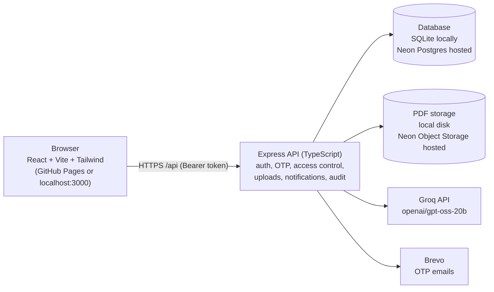

# MedOrg

**Your medical records. One secure place.**

MedOrg is a patient-owned medical record portal. Patients keep their records in one place and decide which doctor can see them, and for how long. Doctors request access, upload PDF reports and prescriptions, and generate an AI summary of a patient's history, but only while the patient's approval is active.

| | |
|---|---|
| **Live app (fully functional)** | https://kryptonix2026.github.io/medorg/ |
| **Sample report pdf for test uploading and summarizing feature** | https://file.garden/aHpR4b_Q5gZVMOAA/Clinical_Consultation_Report.pdf |
| **Demo instruction video** | https://drive.google.com/file/d/13gF5pbDzMo6vubuu26g7IkHU2Upj5KZm/view?usp=sharing |
| **Note** | https://kryptonix2026.github.io/medorg/ |

> The live app runs on free hosting. If nobody has used it for a while, the first request can take up to a minute while the server wakes up. Please wait and refresh once.

---

## Table of contents

1. [What MedOrg does](#what-medorg-does)
2. [How it works](#how-it-works)
3. [Features](#features)
4. [Architecture](#architecture)
5. [Tech stack](#tech-stack)
6. [Run it locally](#run-it-locally)
7. [Environment variables](#environment-variables)
8. [Getting the API keys](#getting-the-api-keys)
9. [Sample accounts](#sample-accounts)
10. [Using the app](#using-the-app)
11. [AI medical-history summary](#ai-medical-history-summary)
12. [Scripts](#scripts)
13. [Project structure](#project-structure)
14. [Deploy for free](#deploy-for-free)
15. [Security and privacy](#security-and-privacy)
16. [Troubleshooting](#troubleshooting)

---

## What MedOrg does

Medical records are usually scattered across hospitals and clinics, and patients have little say over who sees them. MedOrg turns that around:

- Every patient gets a permanent **MedOrg ID** (for example `MED-000001`).
- A doctor can find a patient by that ID and **send an access request**.
- The patient **approves or denies** it, chooses how long it lasts (24 hours, 3 days or 7 days), and confirms an approval with an **email one-time code**.
- While the approval is active, the doctor can read the patient's history, upload new PDF records, and generate an **AI summary** built from the text of those documents.
- The patient can **revoke access at any time**, and the doctor is locked out immediately.

There are only two roles, **Patient** and **Doctor**. There is no hospital account. Doctors enter their hospital or clinic as free text when they register.

---

## How it works

```
Patient registers (National ID + email OTP)
        |
        v
Patient gets a MedOrg ID (MED-000001, MED-000002, ...)
        |
        v
Doctor registers (name, email, medical license number, hospital + email OTP)
        |
        v
Doctor searches the patient by MedOrg ID  ->  sends an access request
        |
        v
Patient sees the request live  ->  picks 24h / 3 days / 7 days
        ->  approves  ->  confirms with an email OTP
        |
        v
Doctor sees the approval live and opens the full medical history
        |
        v
Doctor uploads a PDF (Report or Prescription)  ->  patient sees it
        |
        v
Doctor clicks "Generate Summary"  ->  the server reads the PDF text and
asks the AI model for a concise summary
        |
        v
Patient revokes (or the time runs out)  ->  doctor is locked out at once
```

---

## Features

**Patient portal**
- Register and sign in with an email one-time code. The National ID is a 12-digit number that can be scanned from a photo or typed in.
- MedOrg ID card with copy button and a QR code.
- Medical timeline of every record, newest first, with in-browser PDF viewing and download.
- Incoming access requests that appear live, with approve (duration + OTP), deny and revoke.
- Active grants with a live countdown, and a history of denied, expired and revoked requests.
- Notification bell with unread count.

**Doctor portal**
- Register with a unique medical license number (live "already registered" check) and a free-text hospital.
- Find a patient by exact MedOrg ID and send an access request.
- A clear "Request pending" state, and live updates when the patient approves, denies or revokes. No page reload is needed.
- Full patient history, PDF upload (Report or Prescription) and PDF view and download.
- AI summary of the patient's documents.

**Platform**
- Every record view, download, upload and summary re-checks authorization on the server, every time.
- Audit log of registrations, access events, uploads, views, downloads and summaries.
- Masked live database viewer (5 tabs) for inspection during development.
- Google / Material 3 inspired interface with light and dark themes, built for desktop and mobile.

---

## Architecture



- **Local mode:** SQLite file plus PDFs on disk. Nothing to install except Node.js.
- **Hosted mode:** frontend on GitHub Pages, backend on Render, database on Neon Postgres, PDFs in a private Neon Object Storage bucket. PDFs are never public. They are streamed through the API after an authorization check.

---

## Tech stack

| Layer | Technology |
|---|---|
| Frontend | React 18, Vite 6, TypeScript, Tailwind CSS 4, React Router (HashRouter), Tesseract.js (ID scanning), qrcode.react |
| Backend | Node.js 18+, Express 5, TypeScript, multer, Prisma |
| Database | SQLite (local), Neon Postgres (hosted) |
| File storage | Local disk (local), Neon Object Storage (hosted) |
| AI | Groq API (OpenAI-compatible), model `openai/gpt-oss-20b` |
| Email | Brevo transactional email API |
| Hosting | GitHub Pages (frontend), Render (backend), Neon (data) |

---

## Run it locally

### Requirements

- **Node.js 18 or newer** (20 or 22 LTS recommended) and npm
- Git
- Optional: a Groq API key (AI summary) and a Brevo API key plus verified sender (real OTP emails)

The app starts without the optional keys. Without Groq the AI panel shows "AI is not configured". Without Brevo, OTPs are printed in the server console during development.

### Option 1: Windows one-click

Double-click **`start.bat`** in the project folder. It installs dependencies on the first run, creates your `.env`, starts the API and the web app, and prints the links:

- App: http://localhost:3000
- API health: http://localhost:5000/api/health

### Option 2: Manual

```bash
# 1. Get the code
git clone https://github.com/kryptonix2026/medorg.git
cd medorg

# 2. Create your environment file
#    Windows (PowerShell):  copy .env.example .env
#    macOS / Linux:         cp .env.example .env
#    Then open .env and add your own keys (see "Environment variables").

# 3. Install, create the database and load the sample data
npm install
npm run setup

# 4. Start the API (port 5000) and the web app (port 3000)
npm run dev
```

Open **http://localhost:3000**.

Check that the API is up: **http://localhost:5000/api/health** should return `{"status":"ok"}`.

The masked database viewer is at **http://localhost:3000/#/database** (when `ENABLE_DB_VIEWER=true`).

> Keep the project in a short path such as `C:\MedOrg`. Folders with spaces or brackets in their names can confuse some tools.

---

## Environment variables

Copy `.env.example` to `.env` and fill in the values. **Never commit `.env`.** It is git-ignored, and `.env.example` must contain no real values.

### Core

| Variable | Example / default | Purpose |
|---|---|---|
| `NODE_ENV` | `development` | `production` on hosting |
| `PORT` | `5000` | API port |
| `CLIENT_URL` | `http://localhost:3000` | Web app address |
| `ALLOWED_ORIGINS` | `http://localhost:3000` | Origins allowed to call the API. On hosting, use the origin only, for example `https://kryptonix2026.github.io` (no trailing slash, no path) |
| `DATABASE_URL` | `file:../data/medorg.db` | Local SQLite file, or the Neon connection string when hosted |
| `DATA_DIR` | `./data` | Where local uploads are stored |
| `OTP_SALT` | any long random string | Salt used when hashing OTPs |
| `SESSION_DAYS` | `7` | Login session length |
| `MAX_FILE_SIZE_MB` | `10` locally, `3` hosted | Maximum PDF size |
| `ENABLE_DB_VIEWER` | `true` locally, `false` hosted | Shows the masked database viewer |
| `ALLOW_DB_RESET` | `false` | Allows the viewer's reset button |

### Email (Brevo)

| Variable | Purpose |
|---|---|
| `EMAIL_TRANSPORT` | `api` (recommended, works on free hosting) or `smtp` |
| `BREVO_API_KEY` | Brevo API key |
| `BREVO_FROM_EMAIL` | A sender address you have **verified in Brevo** |
| `BREVO_FROM_NAME` | Display name, for example `MedOrg` |
| `BREVO_SMTP_HOST`, `BREVO_SMTP_PORT`, `BREVO_SMTP_USER`, `BREVO_SMTP_PASSWORD` | Only for `EMAIL_TRANSPORT=smtp` |

### AI (Groq)

| Variable | Value |
|---|---|
| `GROQ_API_KEY` | Your Groq API key |
| `GROQ_BASE_URL` | `https://api.groq.com/openai/v1` |
| `GROQ_MODEL` | `openai/gpt-oss-20b` |

### Hosted mode only

| Variable | Purpose |
|---|---|
| `DB_MODE` | `hosted` when using Neon |
| `STORAGE_DRIVER` | `disk` (local), `s3` (Neon Object Storage) or `db` (PDFs inside Postgres) |
| `DIRECT_URL` | Direct (non-pooled) Neon connection string, used only for schema updates |
| Neon storage variables | The bucket variables Neon provides for the project. See `.env.example` for the exact names |

### Frontend build (GitHub Pages)

Set these as GitHub Actions **variables** (Settings, Secrets and variables, Actions, Variables). They are not secrets:

| Variable | Example |
|---|---|
| `VITE_API_URL` | `https://<your-service>.onrender.com/api` |
| `VITE_BASE_PATH` | `/medorg/` |

---

## Getting the API keys

**Groq (AI summary)**
1. Sign up at **console.groq.com**.
2. Open **API Keys**, create a key and copy it into `GROQ_API_KEY`.
3. Check the model list on the same site to confirm `openai/gpt-oss-20b` is available to you.

**Brevo (OTP emails)**
1. Sign up at **brevo.com** and finish the account activation questions.
2. Click your account name, then **SMTP & API**, then the **API Keys** tab, and generate a key for `BREVO_API_KEY`.
3. Go to **Senders, Domains & Dedicated IPs**, then **Senders**, and add the email address you will send from. Enter the code Brevo emails to that address. Use that address as `BREVO_FROM_EMAIL`.
4. Under **Security**, make sure IP blocking (Authorised IPs) is off, because hosting providers use changing IP addresses.

OTP emails from a personal Gmail sender can land in spam. Check there first if a code does not arrive.

---

## Sample accounts

`npm run setup` loads this sample data:

| Role | Name | Email | ID |
|---|---|---|---|
| Patient | Meera Raghavan | meera.raghavan@example.com | MED-000001 |
| Patient | Thomas Keller | thomas.keller@example.com | MED-000002 |
| Doctor | Dr. Aisha Nair | a.nair@example.com | DOC-0001 |
| Doctor | Dr. Rafael Ortiz | r.ortiz@example.com | DOC-0002 |

It also includes 4 sample PDF records, an active access grant for the first patient, and one denied and one expired request.

These addresses are not real inboxes. **Locally**, sign-in codes for them are printed in the server console in development mode. **On the live site**, register new accounts with real email addresses you can open.

---

## Using the app

**As a patient**
1. Open **Patient portal**, choose **Register**, and enter your name, date of birth, email and 12-digit National ID (type it or scan it).
2. Enter the 6-digit code sent to your email. You land on your dashboard with your MedOrg ID.
3. When a doctor requests access, it appears under **Doctor access**. Choose **Approve with OTP**, pick 24 hours, 3 days or 7 days, and enter the code sent to your email.
4. **Revoke access** at any time from the active grants list.

**As a doctor**
1. Open **Doctor portal**, choose **Register**, and enter your name, email, unique medical license number and hospital.
2. Go to **Find Patient**, enter the patient's MedOrg ID, and send an access request. The status shows **Pending** until the patient decides.
3. When approved, the patient appears under **Authorized Patients**. Open them to see the full history.
4. Use **Upload PDF Record** to add a Report or Prescription, and **Generate Summary** for the AI summary.

---

## AI medical-history summary

When a doctor clicks **Generate Summary**:

1. The server first checks that the doctor is signed in and has an **approved, unexpired, un-revoked** grant for that patient.
2. It extracts the text from the patient's PDF records.
3. It sends that text, with each record's title, type, doctor and date, to the model with a strict instruction: summarize only what is written, invent nothing, and say "not stated in the records" when something is missing.
4. It returns the summary and lists which records were used and which could not be read (for example, scanned images with no selectable text).

The summary is an automated aid and **not a clinical assessment by a person**. Documents are sent to the Groq API to produce it, so only use sample or consented data.

---

## Scripts

| Command | What it does |
|---|---|
| `npm install` | Installs all workspaces |
| `npm run setup` | Creates `.env` if missing, prepares folders, creates the database and loads sample data |
| `npm run dev` | Starts the API (5000) and the web app (3000) together |
| `npm run dev:server` / `npm run dev:client` | Starts one side only |
| `npm run build` | Builds server and client for production |
| `npm start` | Runs the built server |
| `npm run typecheck` | Type-checks both workspaces |
| `npm run db:generate` | Generates the Prisma client |
| `npm run db:push` | Applies the schema to the database |
| `npm run db:seed` | Loads the sample data |
| `npm run db:reset` | Wipes and reloads sample data (local use) |
| `npm run db:studio` | Opens Prisma Studio |
| `npm run ai:test` | Checks the Groq key and model outside the app |
| `npm run test:e2e` | Runs the end-to-end API test of the full workflow |

---

## Project structure

```
medorg/
  client/              React + Vite web app
    src/
      components/      shared UI (header, OTP input, timeline, AI panel, ...)
      pages/           patient/, doctor/, landing, database viewer
      hooks/           auth, theme, live updates
      services/        typed API client
  server/              Express + TypeScript API
    src/
      ai/              Groq summary service and PDF text extraction
      controllers/ routes/ services/ middleware/ email/ db/ utils/
  prisma/              database schema
  scripts/             setup, seed, reset, tests
  data/                local database and uploads (git-ignored)
  .github/workflows/   GitHub Pages deployment
  render.yaml          Render backend configuration
  start.bat            Windows one-click launcher
  .env.example         environment template (no real values)
```

---

## Security and privacy

- **Passwordless sign-in.** Email one-time codes: 6 digits, expire in 10 minutes, maximum 5 attempts, stored only as salted hashes, never returned by the API and never logged.
- **National ID.** Only a salted hash and the last 4 digits are stored. The interface shows `XXXX-XXXX-1234`.
- **Sessions.** Random 256-bit tokens, stored hashed, sent as a Bearer token. Every protected route verifies the session on the server.
- **Access control.** Each record view, download, upload and AI summary re-checks that the doctor is signed in and holds an approved, unexpired, un-revoked grant. Nothing relies on a cached or client-supplied status.
- **Files.** PDF only (MIME type and extension), size-limited, stored under generated names. The original filename is kept only as metadata. Hosted PDFs live in a private bucket and are never exposed by URL.
- **Secrets.** API keys and connection strings are read only on the server from environment variables. They never reach the browser, API responses or logs. `.env` files are git-ignored.
- **Hardening.** Parameterized queries through Prisma, a strict CORS allow-list, security headers, rate limits on code-sending and sign-in routes, and clean JSON errors with no stack traces.
- **Database viewer.** Emails and IDs are masked, and hashes and tokens are never shown. It and its reset button are off by default in production.
- **Data handling.** The AI summary sends document text to a third-party API. Use sample data or data you have consent to process, and do not upload real patient records to the shared hosted instance.

If a key is ever committed or shared by accident, revoke it in the provider's dashboard and create a new one.

---

## Troubleshooting

| Problem | Likely cause and fix |
|---|---|
| "API unavailable" on the landing page | The API is not running or is on a different port. Check `http://localhost:5000/api/health` and that `PORT=5000` in `.env`. On the live site, wait up to a minute for the server to wake and refresh. |
| "AI is not configured" | `GROQ_API_KEY` is missing or the server was not restarted after editing `.env`. Run `npm run ai:test` to see the exact cause. |
| Prisma error: "the URL must start with the protocol `file:`" | `DATABASE_URL` in `.env` is empty or malformed. For local use it should be `file:../data/medorg.db`. |
| OTP email does not arrive | The Brevo sender is not verified, `BREVO_API_KEY` is wrong, or the email is in spam. Locally, read the code from the server console. |
| Browser shows a CORS error | `ALLOWED_ORIGINS` must equal the web app's origin exactly, with no trailing slash and no path. |
| Blank page on GitHub Pages | `VITE_BASE_PATH` must be `/medorg/` (the repository name between slashes). |
| Summary says "not stated in the records" | The PDF has no selectable text (for example, a scan). Use a text-based PDF. |
| Port already in use | Close old terminals running the app, then start again. |
| `npm install` warns about scripts | Newer npm versions block install scripts. Run `npm approve-scripts` if a build step later fails. |

---

## License

Add your license here (for example MIT) and the names of the team members.
